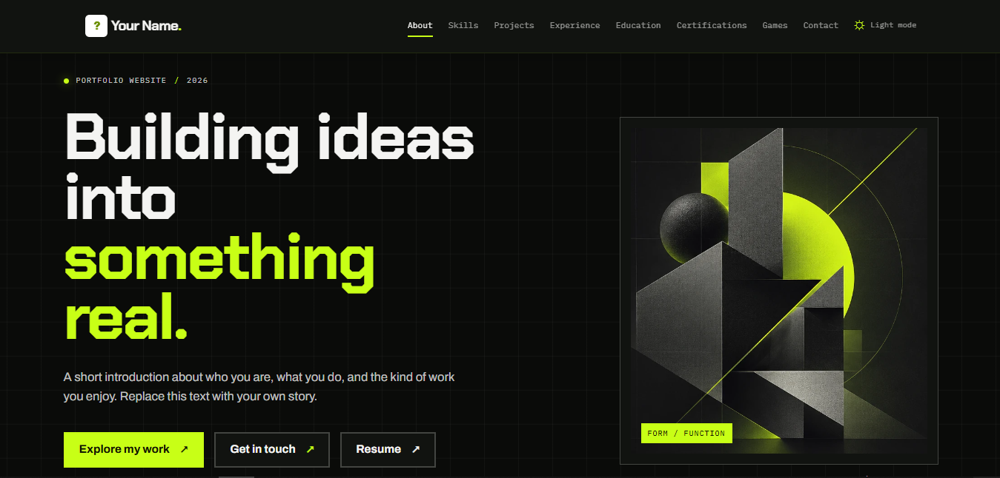
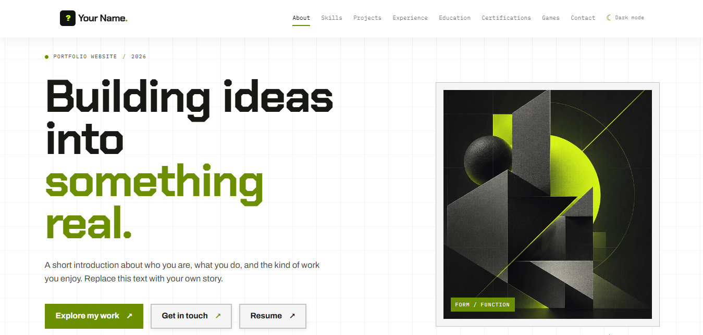

# Portfolio Website Skeleton

A lightweight, responsive, single-page portfolio skeleton built with HTML, CSS, and vanilla JavaScript.

Designed as an independent and customizable starting point for creating a personal portfolio. It features a minimalist editorial layout, technical visual elements, custom branding, and dark and light themes.

This repository serves as a reusable portfolio starter template. You can use it as a foundation, customize its content and appearance, and build your own personal portfolio.

## Preview

### Dark Mode



### Light Mode



## Features

- Responsive single-page portfolio layout
- Eight main sections: About, Skills, Projects, Experience, Education, Certifications, Games, and Contact
- Responsive navigation with a mobile menu
- Sticky header with active-section indication
- Custom RS monogram branding
- Separate browser favicon and theme-aware header/footer logos
- CSS-generated graph background
- Dark and light theme toggle with saved preference
- Numbered contact links with placeholder social profiles
- Resume and navigation call-to-action buttons
- Lenis-powered smooth scrolling
- Floating back-to-top button
- Locally hosted typography and assets
- Reduced-motion support and keyboard-accessible navigation

## Getting Started

### Requirements

- A modern web browser
- A code editor (recommended for customization)

No package installation, JavaScript framework, or build process is required.

### Installation

1. Clone or download this repository.
2. Open the project directory.
3. Open `index.html` in a modern browser.

For local development, you can optionally run a local server:

```bash
python -m http.server 8000
```

Then visit `http://localhost:8000`.

## How to Use This Template

You can create your own independent portfolio using either method:

### Option 1: Use This GitHub Template

1. Visit this repository.
2. Select **Use this template**.
3. Choose **Create a new repository**.
4. Enter your preferred repository name.
5. Create your new repository.
6. Clone your newly created repository to your computer.

This creates a separate repository based on this template, allowing you to customize your portfolio independently.

### Option 2: Download a Release

1. Visit the [Releases page](https://github.com/Grim3ntrix/whoami/releases).
2. Select the version you want to use.
3. Download the ZIP archive.
4. Extract the files.
5. Open the project and start customizing your portfolio.

## Project Structure

```text
whoami-portfolio-skeleton/
│
├── assets/
│   ├── favicon.svg
│   ├── logo-dark.svg
│   └── logo-light.svg
│
├── fonts/
│   ├── archivo-400-normal.woff2
│   ├── archivo-500-normal.woff2
│   ├── archivo-600-normal.woff2
│   ├── archivo-700-normal.woff2
│   ├── chakra-petch-700-normal.woff2
│   ├── ibm-plex-mono-400-italic.woff2
│   ├── ibm-plex-mono-400-normal.woff2
│   ├── ibm-plex-mono-500-normal.woff2
│   └── ibm-plex-mono-600-normal.woff2
│
├── img/
│   ├── portrait-placeholder.webp
│   └── README.md
│
├── .gitignore
├── LICENSE
├── README.md
├── fonts.css
├── index.html
├── lenis.min.js
├── script.js
└── style.css
```

## Customization

The project is intended to be customized. Here are the main files and areas to update:

| Area | Where to customize |
|---|---|
| Personal information and content | `index.html` |
| Contact details and social links | Contact section in `index.html` |
| Resume destination | Resume button in `index.html` |
| Browser favicon | `assets/favicon.svg` |
| Header and footer logos | `assets/logo-dark.svg` and `assets/logo-light.svg` |
| Images and project screenshots | `img/` |
| Typography | `fonts.css` |
| Colors, layout, and responsive styling | `style.css` |
| Navigation, themes, and scrolling | `script.js` |

### Before Publishing Your Personalized Portfolio

- Replace the sample name and placeholder text.
- Add your actual projects, experience, education, and certifications.
- Update the resume destination.
- Replace placeholder email and social profile links.
- Add your own images and profile information.
- Review the browser title and page description.

## Technologies

| Technology | Purpose |
|---|---|
| HTML5 | Page structure and content |
| CSS3 | Styling, layouts, and responsive design |
| Vanilla JavaScript | Interactive functionality |
| Lenis | Smooth scrolling |
| Archivo | Primary typography |
| Chakra Petch | Display typography |
| IBM Plex Mono | Monospaced typography |
| SVG | Branding and favicon assets |

No JavaScript framework or build process is required.

## Design Inspiration

The visual direction takes inspiration from [Mercer Lite](https://github.com/mikesmithdesign/mercer-lite).

This repository is an independent implementation and is not affiliated with or an official version of Mercer Lite. It uses its own structure, styling, branding, and content.

## Releases

Stable versions of this portfolio skeleton are available through [GitHub Releases](https://github.com/Grim3ntrix/whoami/releases).

Each release provides a downloadable snapshot of the project at a specific version.

Versions follow Semantic Versioning:

- **Major:** Significant changes or breaking updates.
- **Minor:** New features and improvements.
- **Patch:** Bug fixes and minor corrections.

## Attribution

If you use this portfolio skeleton as the foundation for your own website, please retain the original template credit in your repository's README.

You may add your own credits alongside it, but please do not remove the original attribution.

**Original template:** [Portfolio Website Skeleton](https://github.com/Grim3ntrix/whoami) by [Grim3ntrix](https://github.com/Grim3ntrix).

## License

Released under the MIT License. See the [LICENSE](LICENSE) file for details.